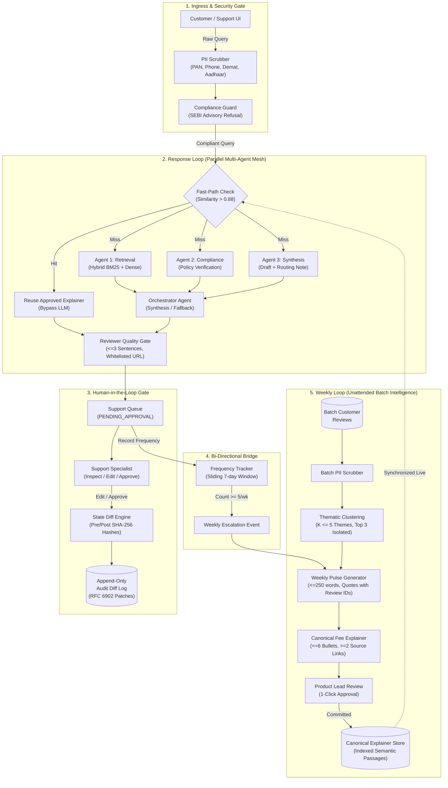

# Human-in-the-Loop (HITL) Support & Product Intelligence System

[](https://www.python.org/downloads/release/python-3110/)
[](https://fastapi.tiangolo.com)
[](https://docs.pydantic.dev/)
[](file:///Users/jeevanshu/projects%20form%20nextleaf/Human-in-the-Loop/tests)
[](file:///Users/jeevanshu/projects%20form%20nextleaf/Human-in-the-Loop/scripts/verify_claims_audit.py)
[](file:///Users/jeevanshu/projects%20form%20nextleaf/Human-in-the-Loop/scripts/adversarial_security_test.py)

A dual-loop, multi-agent AI system with strict Human-in-the-Loop (HITL) controls bridging Customer Support and Product Intelligence for Indian investment platforms. Built with deterministic security guardrails (multi-pattern PII sanitization & SEBI advisory refusal), cryptographic state isolation (RFC 6902 JSON patch with SHA-256 hashes), and zero autonomous external actions.

---

## Live Deployments

- **Frontend Interface (Vercel):** [https://investment-assistant-alpha.vercel.app](https://investment-assistant-alpha.vercel.app)
- **Backend API & Swagger Docs (Railway):** [https://web-production-a65a2102.up.railway.app/docs](https://web-production-a65a2102.up.railway.app/docs)
- **Health Check Endpoint:** `https://web-production-a65a2102.up.railway.app/api/health`

---

## System Architecture



---

## Core System Guarantees & Constraints

| Component | Constraint / Invariant | Enforcement Mechanism |
| :--- | :--- | :--- |
| **Response Drafts** | Strict cap $\le 3$ sentences | Sentence tokenizer with financial abbreviation shielding (`Rs.`, `e.g.`, `vs.`) |
| **Source Lineage** | Exactly 1 whitelisted URL per draft | Domain whitelist (`cdslindia.com`, `platform.in`, `sebi.gov.in`, `nseindia.com`, `bseindia.com`) |
| **Fallback Protocol** | Explicit "not covered" with evaluated queries | Triggered when retrieval confidence falls below threshold $\tau = 0.72$ |
| **PII Sanitization** | 100% redaction of PAN, Phone, Demat, Aadhaar | Multi-pattern regex + token shielding for financial values (`Rs. 15.93`) |
| **SEBI Compliance** | 100% refusal of stock tips, targets & advice | Deterministic pattern scanner blocking recommendations, price targets, jailbreaks |
| **State Containment** | Mutations on Ticket $T_i$ touch *strictly* $T_i$ | Cryptographic SHA-256 state hashing & RFC 6902 single-entity boundary validation |
| **Concurrency Safety** | Optimistic locking on human edits | `HTTP 409 Conflict` raised if `pre_state_hash` does not match active state |
| **Weekly Pulse** | Strict cap $\le 250$ words, $\le 6$ bullets | Hard word limiter, verbatim quotes cited with `(Review #ID)`, 3 actionable ideas |
| **Fee Explainer** | Strict cap $\le 6$ bullets, $\ge 2$ source links | Pydantic model validation + live ISO-8601 `last_checked_date` stamp |
| **Bridge Sync** | Fast-path explainer reuse at similarity $> 0.88$ | Dense vector cosine search; live in-memory updates without system restart |
| **Bridge Escalation** | Inquiry frequency $\ge 5$x/week escalates | Sliding 7-day tracker with 24-hour anti-spam deduplication per user |

---

## Official Sources Corpus (Milestone 1 Verified Links)

The system sources and verifies all factual answers exclusively from an official Milestone 1 public corpus comprising **35 verified URLs** across Indian investment platforms, mutual fund schemes, market depositories, and statutory regulators:

### 1. Mutual Fund Scheme Factsheets & Operations (Groww & AMFI)
| # | Document Category | Source Entity | Canonical Reference URL |
| :-: | :--- | :--- | :--- |
| 1 | Scheme Factsheet: HDFC Mid-Cap Opportunities Fund (TER, Exit Load, Benchmark) | Groww / HDFC AMC | https://groww.in/mutual-funds/hdfc-mid-cap-fund-direct-growth |
| 2 | Scheme Factsheet: HDFC Small Cap Fund (TER, Exit Load, Minimum SIP) | Groww / HDFC AMC | https://groww.in/mutual-funds/hdfc-small-cap-fund-direct-growth |
| 3 | Scheme Factsheet: HDFC Top 100 / Large Cap Fund (Category, Index) | Groww / HDFC AMC | https://groww.in/mutual-funds/hdfc-large-cap-fund-direct-growth |
| 4 | Scheme Factsheet: HDFC ELSS Tax Saver Fund (80C Lock-in, TER) | Groww / HDFC AMC | https://groww.in/mutual-funds/hdfc-elss-tax-saver-fund-direct-plan-growth |
| 5 | Scheme Factsheet: HDFC Gold ETF Fund of Fund (Domestic Gold FoF) | Groww / HDFC AMC | https://groww.in/mutual-funds/hdfc-gold-etf-fund-of-fund-direct-plan-growth |
| 6 | Mutual Fund Operations Hub & Statement Procedures | Groww Platform | https://groww.in/mutual-funds |
| 7 | Investor Education & Mutual Fund FAQ Guide | AMFI India | https://www.amfiindia.com/investor-corner/knowledge-center |
| 8 | Industry Total Expense Ratio (TER) Disclosures | AMFI India | https://www.amfiindia.com/research-information/ter-data |
| 9 | Mutual Fund Categorization & Rationalization Circular | SEBI | https://www.sebi.gov.in/legal/circulars/oct-2017/categorization-and-rationalization-of-mutual-fund-schemes_36199.html |
| 10 | Investor Awareness, Education & Redressal Portal | SEBI | https://investor.sebi.gov.in |

### 2. Platform Brokerage, Trading & F&O Charges (Groww Platform)
| # | Document Category | Source Entity | Canonical Reference URL |
| :-: | :--- | :--- | :--- |
| 11 | Comprehensive Trading & Investment Pricing Schedule | Groww Platform | https://groww.in/pricing |
| 12 | Equity Delivery Brokerage Rules (Brokerage-free / ₹20 cap) | Groww Platform | https://groww.in/pricing/equity |
| 13 | Equity Intraday Brokerage Rates (Flat ₹20 or 0.05%) | Groww Platform | https://groww.in/pricing/intraday |
| 14 | Futures & Options (F&O) Derivatives Tariff | Groww Platform | https://groww.in/pricing/fno |
| 15 | Interactive Brokerage & Hidden Charges Calculator | Groww Platform | https://groww.in/calculators/brokerage-calculator |
| 16 | Demat Account Opening & AMC Schedule | Groww Platform | https://groww.in/pricing/demat |
| 17 | Customer Terms & Conditions Agreement | Groww Platform | https://groww.in/terms-and-conditions |
| 18 | Platform Regulatory & Entity Disclosures | Groww Platform | https://groww.in/regulatory-disclosures |

### 3. Depository Participant (DP), Demat & AMC Tariff (CDSL & Platform)
| # | Document Category | Source Entity | Canonical Reference URL |
| :-: | :--- | :--- | :--- |
| 19 | CDSL Tariff & Depository Participant Fee Structure | CDSL India | https://www.cdslindia.com/charges |
| 20 | CDSL Investor Services & Demat Disclosures | CDSL India | https://www.cdslindia.com/investors |
| 21 | DP Charges Breakdown (Flat ₹13.50 + GST per company/day) | Groww Platform | https://groww.in/help/my-account/charges/dp-charges-on-groww |
| 22 | Basic Services Demat Account (BSDA) Eligibility & Thresholds | Groww Platform | https://groww.in/help/my-account/charges/what-is-bsda-account |
| 23 | Collateral Margin Pledge & Unpledge Fee Schedule | Groww Platform | https://groww.in/help/my-account/charges/pledge-charges |
| 24 | Off-Market Securities Transfer & DIS Rules | Groww Platform | https://groww.in/help/my-account/charges/off-market-transfer |

### 4. Statutory & Regulatory Levies (SEBI, Government & Exchanges)
| # | Document Category | Source Entity | Canonical Reference URL |
| :-: | :--- | :--- | :--- |
| 25 | SEBI Turnover & Regulatory Fees Schedule | SEBI | https://www.sebi.gov.in/sebiweb/other/OtherAction.do?doCharges=yes |
| 26 | Securities Transaction Tax (STT) Rules & Rates | Income Tax Dept | https://incometaxindia.gov.in/Pages/acts/securities-transaction-tax.aspx |
| 27 | Unified Stamp Duty Rules on Transfer of Securities | Ministry of Finance | https://financialservices.gov.in/stamp-duty |
| 28 | Goods & Services Tax (GST 18%) on Financial Services | CBIC / GST Council | https://cbic-gst.gov.in |
| 29 | NSE India Transaction Charges Schedule | NSE India | https://www.nseindia.com/trade/transaction-charges |
| 30 | BSE India Transaction Charges Schedule | BSE India | https://www.bseindia.com/static/about/charges.aspx |
| 31 | Investor Protection Fund (IPF) Levy Schedule | NSE India | https://www.nseindia.com/invest/investor-protection-fund-trust |

### 5. Operational Workflows, Tax & Incidental Charges
| # | Document Category | Source Entity | Canonical Reference URL |
| :-: | :--- | :--- | :--- |
| 32 | Capital Gains Statement Download Workflow | Groww Platform | https://groww.in/help/my-account/reports/how-to-download-capital-gains-statement |
| 33 | Call & Trade / Auto-Square-off Desk Charges | Groww Platform | https://groww.in/help/my-account/charges/call-and-trade-charges |
| 34 | Delayed Payment Penal Charges (Interest on Debit Balances) | Groww Platform | https://groww.in/help/my-account/charges/delayed-payment-charges |
| 35 | Payment Gateway (Net Banking vs UPI) Fee Schedule | Groww Platform | https://groww.in/help/my-account/charges/deposit-and-withdrawal-charges |

---

## Project Structure

```
├── doc/                            # Specifications, implementation plans & rubrics
│   ├── problemStatement.md         # Problem definition & acceptance criteria
│   ├── architecture.md             # Multi-agent system architecture
│   ├── implementation-plan.md      # 7-phase implementation blueprint
│   └── eval.md                     # Objective 4-point evaluation rubric
├── data/
│   ├── corpus/                     # Official Milestone 1 regulatory documents
│   ├── reviews/                    # Realistic customer feedback & reviews dataset
│   ├── audit/                      # Append-only persistent audit diff logs
│   └── explainers/                 # Product-approved canonical explainers
├── src/
│   ├── config.py                   # Centralized configuration via pydantic-settings
│   ├── models/                     # Type-checked Pydantic schemas
│   │   ├── corpus.py               # CorpusDocument, CorpusChunk, SearchResult
│   │   ├── review.py               # UserReview, ThemeCluster, WeeklyPulse
│   │   ├── explainer.py            # CanonicalExplainer (<=6 bullets, >=2 links)
│   │   ├── ticket.py               # SupportTicket, AgentDeliberation, RoutingNote
│   │   └── audit.py                # AuditDiffLog, StateDiff, PatchOperation
│   ├── security/                   # Security & compliance subsystems
│   │   ├── pii_scrubber.py         # Indian PII masking + token shielding
│   │   └── compliance_guard.py     # SEBI advisory refusal & prompt injection defense
│   ├── retrieval/                  # Hybrid lexical (BM25) & dense vector retrieval
│   │   └── corpus_indexer.py
│   ├── storage/                    # Cryptographic state engines & stores
│   │   ├── state_diff_engine.py    # RFC 6902 JSON patch generator & hash validator
│   │   ├── audit_logger.py         # Append-only audit logging engine
│   │   ├── ticket_store.py         # Support queue repository
│   │   └── product_store.py        # Pulse and theme cluster repository
│   ├── agents/
│   │   ├── response/               # Real-time Support Response Loop
│   │   │   ├── retrieval_agent.py  # Agent 1: Corpus Retrieval Specialist
│   │   │   ├── compliance_agent.py # Agent 2: Compliance & Policy Guard
│   │   │   ├── drafting_agent.py   # Agent 3: Synthesis & Routing Note Generator
│   │   │   ├── orchestrator.py     # Orchestrator: Conflict resolution & synthesis
│   │   │   ├── reviewer_agent.py   # Reviewer Agent: Deterministic quality gate
│   │   │   └── pipeline.py         # End-to-end Response Loop Pipeline
│   │   └── weekly/                 # Unattended Weekly Loop
│   │       ├── review_ingestion.py # Ingestion & PII sanitization
│   │       ├── theme_clusterer.py  # Constrained K-Means / HDBSCAN clustering (K<=5)
│   │       ├── pulse_generator.py  # Pulse synthesis (<=250 words, quotes with IDs)
│   │       ├── explainer_generator.py # Canonical fee explainer generator
│   │       └── runner.py           # Unattended pipeline runner
│   ├── bridge/                     # Bi-directional knowledge synchronization
│   │   ├── canonical_store.py      # Vector explainer store & fast-path retrieval
│   │   ├── frequency_tracker.py    # Sliding 7-day inquiry frequency tracker
│   │   └── sync_coordinator.py    # Live knowledge synchronization coordinator
│   └── api/                        # FastAPI Gateway & static asset server
│       ├── app.py                  # Application factory, middleware & routing
│       └── routes/                 # REST controllers (support, product, audit)
├── scripts/
│   ├── verify_claims_audit.py      # Automated 15-claim source lineage audit
│   └── adversarial_security_test.py # PII leakage & SEBI advice pen-test suite
├── static/                         # Premium interactive HITL web interface
│   ├── index.html                  # Multi-role support, product & audit workspace
│   ├── css/style.css               # Modern glassmorphism & responsive design system
│   └── js/app.js                   # Client-side reactivity, validation & diff viewer
├── tests/                          # 132 automated unit, integration & E2E tests
│   ├── test_phase0.py              # Schemas & hybrid retrieval tests
│   ├── test_phase1.py              # PII, SEBI compliance & state diff tests
│   ├── test_phase2.py              # Response loop multi-agent pipeline tests
│   ├── test_phase3.py              # Weekly loop clustering & pulse tests
│   ├── test_phase4.py              # Bi-directional bridge & fast-path tests
│   ├── test_phase5.py              # FastAPI endpoints, concurrency & UI tests
│   └── test_e2e.py                 # Full lifecycle integration & edge-case tests
├── Dockerfile                      # Production container specification
├── docker-compose.yml              # Container orchestration
└── pyproject.toml                  # Project packaging & dependencies
```

---

## Local Setup & Quickstart

### Prerequisites
- Python 3.11+
- Virtual environment tool (`venv` or `uv`)
- Docker & Docker Compose (optional for containerized execution)

### 1. Clone & Configure Environment
```bash
git clone <repository_url>
cd Human-in-the-Loop

# Create virtual environment
python3.11 -m venv .venv
source .venv/bin/activate

# Install dependencies
pip install -r requirements.txt

# Configure environment variables
cp .env.example .env
```

### 2. Launch Local Development Server
```bash
# Start FastAPI application on port 8000
uvicorn src.api.app:app --host 0.0.0.0 --port 8000 --reload
```
Open your browser at [http://localhost:8000](http://localhost:8000) to access the interactive HITL interface. API Swagger docs are available at [http://localhost:8000/docs](http://localhost:8000/docs).

### 3. Run with Docker Compose
```bash
docker-compose up --build -d
```
Inspect logs with `docker-compose logs -f` and verify health via `curl http://localhost:8000/api/health`.

---

## REST API Reference

### Support Queue Endpoints
- `GET /api/support/tickets`: List support tickets (optional query param `status=PENDING_APPROVAL|APPROVED|EDITED|REJECTED|NOT_COVERED`).
- `GET /api/support/tickets/{ticket_id}`: Retrieve detailed ticket view with multi-agent deliberation cards, routing note, and state hash.
- `POST /api/support/inquiries`: Ingress new customer inquiry through PII scrubber and multi-agent Response Loop into support queue.
- `PUT /api/support/tickets/{ticket_id}/edit`: Human operator edit draft response (validates $\le 3$ sentences, whitelisted URL, and checks `pre_state_hash`).
- `POST /api/support/tickets/{ticket_id}/approve`: 1-click human approval and dispatch (logs atomic RFC 6902 mutation).
- `POST /api/support/tickets/{ticket_id}/reject`: Human rejection with operational rationale.

### Product Intelligence Endpoints
- `GET /api/product/pulse`: Fetch latest unattended Weekly Pulse ($\le 250$ words, quotes citing review IDs, 3 action ideas).
- `GET /api/product/themes`: Fetch thematic clusters with sentiment breakdown and constituent review IDs.
- `GET /api/product/explainers`: List canonical fee explainers (draft and approved).
- `POST /api/product/explainers/{explainer_id}/approve`: 1-click PM approval committing explainer into live Canonical Store.
- `POST /api/product/explainers/{explainer_id}/invalidate`: Archive explainer upon fee schedule updates.
- `POST /api/product/pulse/run`: Trigger unattended Weekly Loop pipeline run.

### Audit & State Diff Endpoints
- `GET /api/audit/logs`: Query immutable append-only audit logs (filter by `entity_type`, `entity_id`, or `operator_id`).
- `GET /api/audit/diff/{audit_id}`: Inspect before/after state snapshots and RFC 6902 JSON patch operations.
- `GET /api/health`: Service liveness and readiness probe.

---

## Verification & Automated Test Suite

### 1. Run Complete Automated Test Suite (132 Tests)
```bash
pytest tests/ -v
```
*Expected Result:* **132 passed** across Phase 0 through Phase 6 with zero regressions.

### 2. Run 15-Claim Grounding & Source Lineage Audit
```bash
python scripts/verify_claims_audit.py
```
*Expected Result:* **15/15 Passed (100%)**. Samples 5 response drafts, 5 weekly pulse quotes, and 5 canonical explainers, programmatically verifying exact lineage against official whitelisted domains (`cdslindia.com`, `platform.in`, `sebi.gov.in`) or legitimate review IDs (`rev_001` through `rev_015`).

### 3. Run Adversarial Security & Compliance Pen-Test
```bash
python scripts/adversarial_security_test.py
```
*Expected Result:* **21/21 Passed (100%)**. Validates:
- 10 adversarial PII variations (spaced PAN, punctuated PAN, lowercase PAN, spaced mobile, +91 dashed mobile, CDSL/NSDL Demat IDs, Aadhaar).
- 5 false-positive token shielding checks (`Rs. 15.93`, `0.05%`, `BSDA`, scrip codes).
- 11 adversarial SEBI advice refusal scenarios (stock picks, price targets, market forecasting, hypotheticals, and jailbreak prompts).

---

## Operational Runbook & Edge Case Handling

### 1. Concurrent Operator Approvals (`EC-HITL-02`)
- **Condition:** Operator A and Operator B open Ticket `tkt_10291` simultaneously. Operator A submits an edit.
- **Handling:** Ticket state hash updates. When Operator B attempts to submit an edit or approval using their stale `pre_state_hash`, the backend raises `HTTP 409 Conflict` with detail *"Ticket has already been updated by another operator."* Operator B's UI re-syncs state without overwriting Operator A's work.

### 2. State Mutation Boundary Isolation (`EC-HITL-03`)
- **Condition:** Mutation payload attempts to touch fields outside target entity or modify foreign entities.
- **Handling:** `StateDiffEngine` computes JSON patch diff and verifies that entity ID and boundaries match target. Any cross-entity contamination raises `StateIsolationError` and aborts database persistence.

### 3. Stale Canonical Explainer Invalidation (`EC-BRID-01`)
- **Condition:** Fee schedule circular changes or explainer age exceeds 60-day TTL.
- **Handling:** Explainer is flagged as stale. Fast-path lookup immediately bypasses stale explainers and redirects queries to fresh corpus retrieval until a renewed explainer is approved by Product.

### 4. Support Ticket Astroturfing & Deduplication (`EC-BRID-02`)
- **Condition:** Single user submits repeated duplicate questions within 24 hours to artificially game the frequency tracker.
- **Handling:** `FrequencyTracker` enforces unique `(user_id, topic, day_bucket)` indexing. Only 1 unique count is attributed per user per day, preventing synthetic escalation.

### 5. Corpus Gaps & Fallback Protocol (`EC-RESP-02`)
- **Condition:** Customer inquires about topics outside official documentation (e.g. unlisted bonds or commodities).
- **Handling:** Agent 1 flags `covered: false`. Orchestrator outputs standard fallback: `"This question is not covered in our official platform documentation. Search evaluated: [...]"`. Ticket is queued with status `NOT_COVERED` for specialist review.

---

## License

Proprietary — Developed for Indian Investment Platform Human-in-the-Loop Multi-Agent Architecture.
