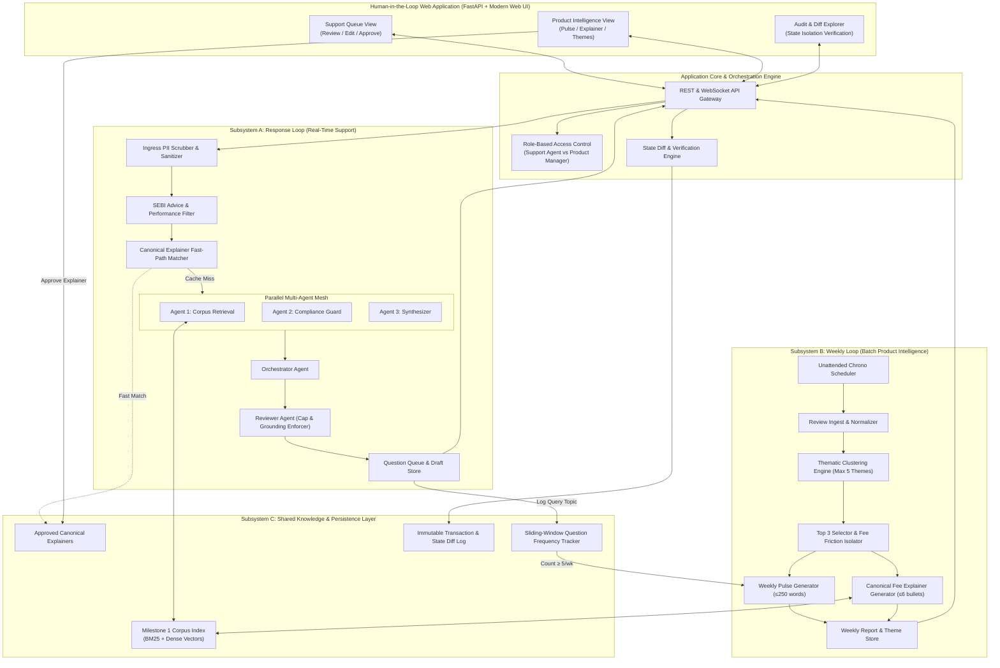
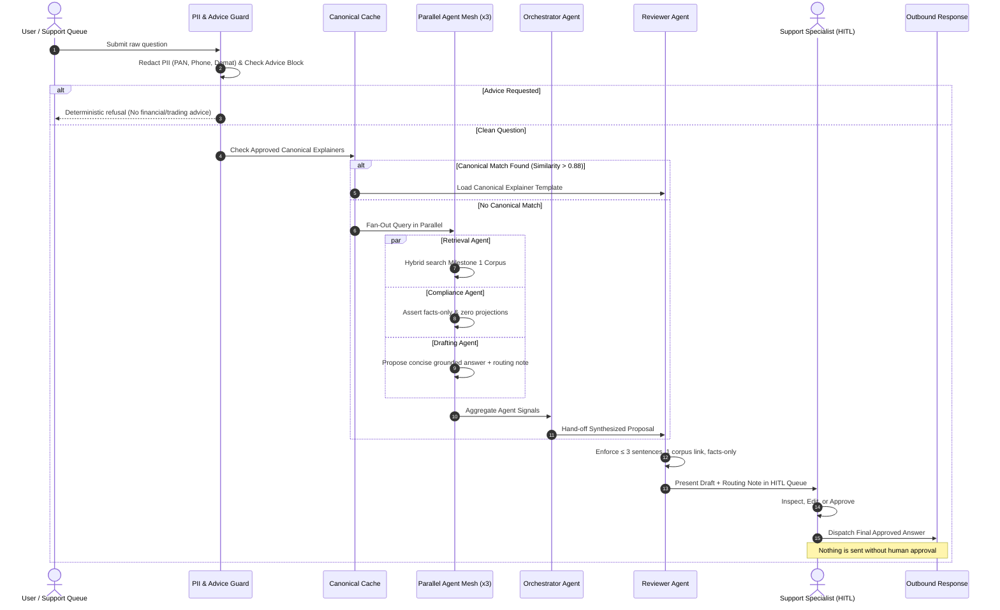
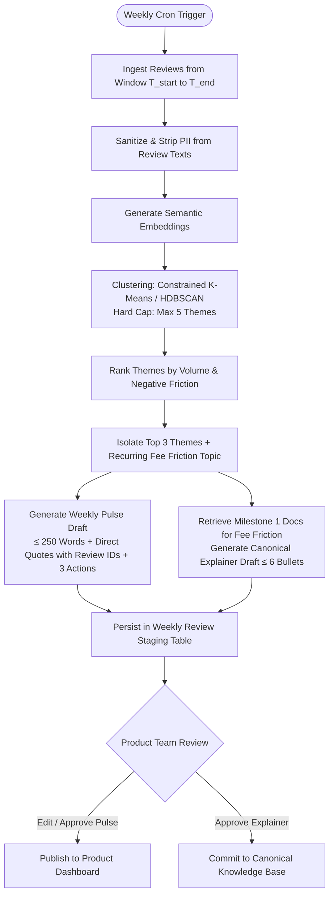
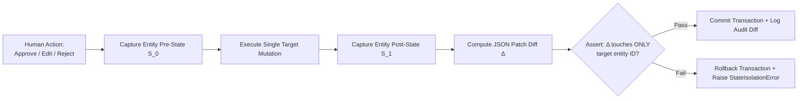
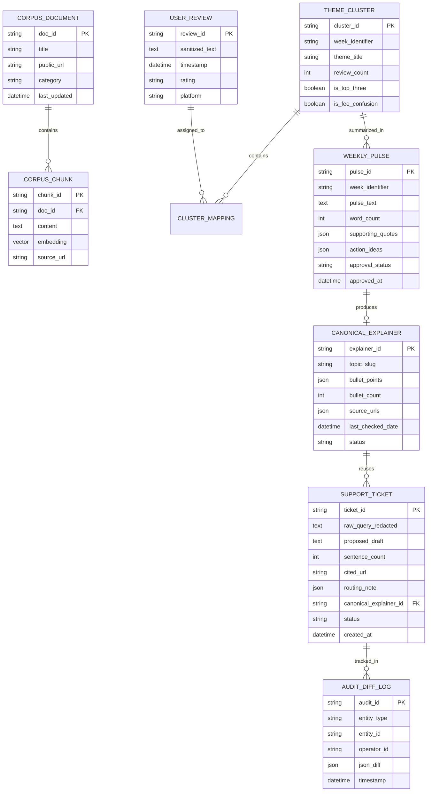

# System Architecture Specification: Human-in-the-Loop (HITL) Support & Product Intelligence System

## 1. Architectural Vision & Core Principles

This system bridges the operational gap between **Customer Support** and **Product Teams** at an Indian investment platform through a dual-loop, multi-agent architecture with strict **Human-in-the-Loop (HITL)** controls.

```
       ┌─────────────────────────────────────────────────────────────┐
       │                 HUMAN-IN-THE-LOOP WEB APP                   │
       │   Support Desk (Draft Approval)  │  Product Portal (Pulse)  │
       └──────────────────────────────┬──────────────────────────────┘
                                      │
            ┌─────────────────────────┴─────────────────────────┐
            │                                                   │
            ▼                                                   ▼
┌───────────────────────┐                           ┌───────────────────────┐
│     RESPONSE LOOP     │◄───── Canonical Answers ──┤      WEEKLY LOOP      │
│  (Support Inquiries)  │── Questions ≥ 5x/wk ────►│   (Reviews & Trends)  │
└───────────────────────┘                           └───────────────────────┘
            │                                                   │
            ▼                                                   ▼
┌───────────────────────┐                           ┌───────────────────────┐
│ 3-Agent Parallel Pipe │                           │ Ingestion & Cluster   │
│  Orchestrator Review  │                           │ Pulse (≤250w) + Links │
└───────────────────────┘                           └───────────────────────┘
            │                                                   │
            ▼                                                   ▼
 ┌─────────────────────────────────────────────────────────────────────────┐
 │               CORE INFRASTRUCTURE & SHARED ENFORCEMENT                  │
 │   Corpus Retrieval (BM25+Dense) │ PII Scrubber │ Immutable State & Diff │
 └─────────────────────────────────────────────────────────────────────────┘
```

### Core Design Tenets
1. **Deterministic Safety Before Generative Freedom:** Strict programmatic guardrails (PII redaction, financial advice refusal, sentence/word caps) execute before and after LLM operations.
2. **Milestone 1 Corpus Grounding:** No factual claim is emitted without an explicit public source link from the curated Milestone 1 official documentation.
3. **Explicit Fallback Protocol:** If the corpus does not cover an inquiry, the system explicitly reports non-coverage and details the exact search queries evaluated.
4. **Absolute State Containment:** Every user interaction, human edit, or approval mutates exclusively the targeted entity, verified via before-and-after cryptographic state diffs.
5. **Zero-PII Storage Policy:** Personally Identifiable Information (PAN, Aadhaar, account/demat numbers, phone numbers) is scrubbed at the perimeter and never enters logs, vector stores, or agent state graphs.

---

## 2. High-Level System Architecture

The solution is partitioned into modular subsystems communicating through clean data boundaries:



---

## 3. Subsystem Breakdown

### 3.1 Subsystem A: The Response Loop (Support Inquiries)

The Response Loop resolves incoming support tickets by pairing parallel agent execution with an uncompromising human approval barrier.



#### Detailed Agent Specifications
1. **Agent 1: Corpus Retrieval Specialist**
   - **Role:** Executes hybrid search (BM25 lexical + dense embeddings via `all-MiniLM-L6-v2` or similar) against the Milestone 1 corpus.
   - **Relevance Threshold ($\tau_{rel}$):** Requires cosine similarity $\ge 0.72$ and positive BM25 overlap score.
   - **Fallback Condition:** If top candidate score $< \tau_{rel}$, explicitly flags:
     ```json
     {
       "covered": false,
       "searched_queries": ["STT charges on equity delivery", "Securities Transaction Tax rates"],
       "reason": "Corpus does not contain official disclosures for this inquiry."
     }
     ```
2. **Agent 2: Compliance & Policy Guard**
   - **Role:** Validates SEBI Regulatory Compliance.
   - **Enforcement:** Disallows terms signaling investment advice (`buy`, `sell`, `accumulate`, `target price`, `expected return`, `multibagger`, `portfolio allocation`).
   - **Action:** If advice detected, forces refusal template and bypasses drafting.
3. **Agent 3: Response Synthesis Agent**
   - **Role:** Generates candidate answer strictly restricted to context returned by Agent 1.
   - **Routing Metadata:** Produces internal routing notes:
     - `category`: `[BROKERAGE, STATUTORY_CHARGES, DP_CHARGES, ACCOUNT_MAINTENANCE, PAYMENT_GATEWAY, OTHERS]`
     - `urgency`: `[LOW, MEDIUM, HIGH, ESCALATE]`
     - `sentiment`: `[NEUTRAL, CONFUSED, FRUSTRATED]`
     - `reason`: Internal explanation justifying the routing and drafted reply.
4. **Orchestrator Agent**
   - Combines parallel outputs, resolves conflicts, and structures payload for the Reviewer.
5. **Reviewer Agent (Deterministic Quality Gate)**
   - **Sentence Counter:** Natural Language Toolkit (NLTK) / spaCy sentence boundary tokenizer enforcing $count(sentences) \le 3$.
   - **Citation Validator:** Validates that exactly one official Milestone 1 URL is embedded in the response text.
   - **PII Leak Sweep:** Secondary validation confirming zero residual PII before queuing for human review.

---

### 3.2 Subsystem B: The Weekly Loop (Product Intelligence)

The Weekly Loop runs unattended on a scheduled background worker (e.g., cron or asynchronous pipeline worker), processing customer feedback batches into executive summaries and canonical explainer drafts.



#### Detailed Specifications
1. **Thematic Clustering Engine:**
   - **Constraint:** Maximum of 5 clusters ($\le 5$ themes).
   - **Isolation:** Identifies the top 3 themes by review frequency, plus explicitly extracts the dominant fee/charge friction sub-theme.
   - **Traceability:** Every theme maintains an immutable list of child `review_id` references for 100% data lineage.
2. **Weekly Pulse Generator:**
   - **Length Cap:** $\le 250$ words.
   - **Supporting Quotes:** Incorporates 2–3 verbatim user quotes tagged with `(Review #ID)`.
   - **Actionable Ideas:** Exactly three (3) concrete product recommendations addressing the friction points.
3. **Canonical Fee Explainer Generator:**
   - **Format:** Bulleted list of $\le 6$ concise bullets.
   - **Grounding:** Contains $\ge 2$ distinct official source links from the Milestone 1 corpus.
   - **Timestamp:** Explicit `last_checked_date` (ISO-8601).
   - **Lifecycle:** Once approved by the Product Manager, stored in `canonical_explainers` table and indexed for instant retrieval by the Response Loop.

---

### 3.3 Subsystem C: The Bi-Directional Bridge

The bi-directional bridge establishes active synchronization between operational support and product development:

```
┌─────────────────────────────────────────────────────────────────────────┐
│                          BI-DIRECTIONAL BRIDGE                          │
│                                                                         │
│   Direction 1: Weekly Loop ────────► Response Loop                      │
│   - Product Manager approves a Fee Explainer in the Weekly Loop.       │
│   - Explainer is committed to CanonicalDB with semantic embeddings.     │
│   - Response Loop checks CanonicalDB first; matching questions get      │
│     the standardized canonical answer instead of drafting fresh.        │
│                                                                         │
│   Direction 2: Response Loop ──────► Weekly Loop                        │
│   - Response Loop tracks question topic occurrences in sliding window.  │
│   - Any question topic seen ≥ 5 times in a single week triggers a flag. │
│   - Flagged topics are automatically injected into the next Weekly     │
│     Pulse run under "High-Frequency Support Inquiries".                 │
└─────────────────────────────────────────────────────────────────────────┘
```

---

## 4. Security, Privacy & Compliance Architecture

### 4.1 Strict Zero-PII Enforcement Pipeline
All text entering the system passes through a two-stage PII scrubbing pipeline:

```
Raw Input ──► [Stage 1: Regex Masking] ──► [Stage 2: Entity Recognition] ──► Sanitized Output
```

- **Regex Rules (Indian Financial Identifiers):**
  - **PAN Card:** `[A-Z]{5}[0-9]{4}[A-Z]` $\rightarrow$ `[REDACTED_PAN]`
  - **Indian Mobile Number:** `(?:\+91[\-\s]?)?[6-9]\d{9}` $\rightarrow$ `[REDACTED_PHONE]`
  - **Aadhaar Number:** `\b[2-9]\d{3}\s?\d{4}\s?\d{4}\b` $\rightarrow$ `[REDACTED_AADHAAR]`
  - **Demat / Client ID:** `\b\d{8,16}\b` $\rightarrow$ `[REDACTED_ACCOUNT]`
  - **Email Address:** `[a-zA-Z0-9_.+-]+@[a-zA-Z0-9-]+\.[a-zA-Z0-9-.]+` $\rightarrow$ `[REDACTED_EMAIL]`
- **Storage Protection:** Raw unredacted strings are never persisted to disk, vector embeddings, runtime caches, or log outputs.

### 4.2 Regulatory Compliance & Guardrails (SEBI Rules)
- **Zero Advisory Guarantee:** Deterministic keyword and semantic classifier rejecting advice queries (e.g., *"Should I buy Suzlon?"*, *"What returns will I get?"*).
- **Refusal Response:**
  > *"We do not provide investment advice, trading recommendations, or return projections. For factual inquiries regarding platform fees, charges, or account maintenance, please refer to our official fee schedule."*

### 4.3 Milestone 1 Corpus Grounding Rules
- **Whitelisted Domains Only:** Citations are strictly restricted to verified official public documentation URLs (e.g., `https://platform.in/charges`, `https://platform.in/terms`, `https://sebi.gov.in/...`).
- **One Citation Per Response:** Every factual claim emitted in the response loop must cite exactly one verified source URL from the Milestone 1 corpus.

---

## 5. Human-in-the-Loop (HITL) State & Mutation Isolation

To guarantee that human actions do not cause cascading side-effects, the system enforces **atomic, single-entity mutations** backed by cryptographic diff tracking.



### State Isolation Guarantee
- **Invariant:** A mutation on Ticket $T_i$ cannot modify Ticket $T_j$ ($i \ne j$), nor can it modify any Weekly Pulse or Explainer state.
- **Diff Storage:** Every human operation writes an entry to `audit_diff_log`:
  ```json
  {
    "audit_id": "aud_8492049",
    "timestamp": "2026-11-25T20:55:00Z",
    "user_id": "agent_rahul",
    "entity_type": "ticket",
    "entity_id": "tkt_10293",
    "action": "EDIT_AND_APPROVE",
    "pre_state_hash": "e3b0c44298fc1c149afbf4c8996fb92427ae41e4649b934ca495991b7852b855",
    "post_state_hash": "a152e84173914146e4c523fc9f90ac11f1e60012267b557346b71f3535f5a45c",
    "diff": [
      { "op": "replace", "path": "/draft_reply", "value": "Equity delivery is zero brokerage. Regulatory charges like STT apply as per government norms. Source: https://platform.in/charges" },
      { "op": "replace", "path": "/status", "value": "APPROVED" }
    ]
  }
  ```

---

## 6. Database Schema & Data Models



---

## 7. Web Application User Interface Architecture

The web application is structured into three dedicated, role-aware operational views:

### 7.1 Support Operations Queue View
- **Ticket List:** Real-time stream of incoming customer queries with status badges (`PENDING_APPROVAL`, `APPROVED`, `EDITED`, `REJECTED`, `NOT_COVERED`).
- **Review Canvas:**
  - Original sanitized user inquiry.
  - Multi-Agent deliberation insights (Agent 1 retrieval confidence, Agent 2 policy clearance, Agent 3 draft).
  - Draft response editor (strictly validating $\le 3$ sentences and $\ge 1$ verified source link in real-time).
  - Internal routing note drawer (ticket categorization, sentiment, and escalation reason).
- **Actions:** One-click `Approve & Dispatch`, `Edit & Approve`, or `Reject / Escalate`.

### 7.2 Product Intelligence View
- **Weekly Pulse Dashboard:**
  - Executive 250-word Pulse summary.
  - Interactive quotes linked directly to raw review IDs.
  - 3 concrete action ideas with assignment/tracking status.
- **Top 5 Themes Breakdown:** Visual distribution of clusters with top 3 highlighted and recurring fee confusion isolated.
- **Canonical Explainer Reviewer:**
  - Preview of generated $\le 6$-bullet explainer with verified Milestone 1 source links and `last_checked_date`.
  - One-click `Approve as Canonical Answer` button, immediately feeding into the Response Loop.

### 7.3 State Audit & Diff Explorer View
- Visual before-and-after JSON patch diffs for every support ticket and weekly report action.
- Real-time cryptographic validation proving state containment across the entire database.
- Audit export for regulatory and compliance review.

---

## 8. Verification & Testing Strategy

The implementation is validated against the four mandatory success criteria through automated test suites:

| Success Criteria | Verification Test Suite | Passing Threshold |
| :--- | :--- | :--- |
| **Exhaustive Query Coverage** | `tests/test_response_loop.py` | 100% of queries produce either $\le 3$ sentences with citations or explicit "not covered" with searched terms. |
| **Unattended Weekly Execution** | `tests/test_weekly_loop.py` | Runs end-to-end without user input; pulse $\le 250$ words; explainer $\le 6$ bullets; clusters $\le 5$; all quotes mapped to review IDs. |
| **State Mutation Containment** | `tests/test_state_isolation.py` | State diff before and after action touches exactly 1 entity record; zero cross-table or cross-entity mutations. |
| **Grounding & Zero PII Leakage** | `tests/test_security_grounding.py` | 15 randomized claims verified against official corpus links or review IDs; 100% refusal on financial advice; 100% redaction of PAN, Phone, Demat numbers across logs and state. |

---

## 9. Technology Stack

- **Backend Runtime:** Python 3.11+
- **API Framework:** FastAPI (High performance, async native, OpenAPI specification)
- **Agent Orchestration:** LangGraph / StateGraph (Deterministic state machine with cyclical multi-agent graph capabilities)
- **Retrieval & Search:** BM25 (Rank-BM25) + ChromaDB / FAISS (Dense vector similarity)
- **NLP & Clustering:** Scikit-learn (K-Means / HDBSCAN, TF-IDF), spaCy / NLTK (Sentence boundaries & entity detection)
- **Database & Storage:** PostgreSQL / SQLite (with JSONB support and transactional integrity)
- **Frontend Interface:** Modern HTML5 / Vanilla CSS / Vanilla JS (Clean, high-performance, reactive UI without unnecessary bundle bloat)
- **Testing Framework:** Pytest with coverage and schema verification
