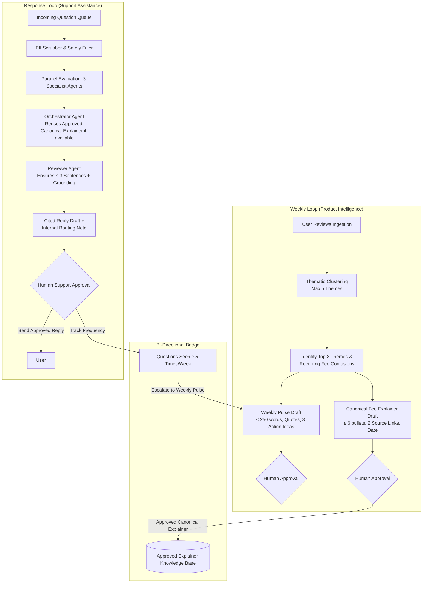

# Project Problem Statement: Human-in-the-Loop Support & Product Intelligence System

## 1. Executive Summary

At an Indian investment platform, the **Customer Support** and **Product** teams operate with fragmented views of the same recurring problem: **user confusion regarding fees, charges, and account policies**.

- **Customer Support** answers repetitive fee and charge queries dozens of times every month. Each response is manually composed ad-hoc, resulting in factual discrepancies, tone inconsistencies, and wasted operational effort.
- **Product** monitors high-level feedback dashboards indicating general signals like *"pricing confusion is up"*, but lacks granular visibility into which specific fees cause friction, what exact explanations Support communicates, or how frequently specific questions reoccur.

The underlying failure is the lack of a unified, authoritative system connecting official platform disclosures, actual user confusion patterns, and support communication.

To resolve this, we are building a deployed, **Human-in-the-Loop (HITL)** web application that bridges both operational halves through two scheduled, interconnected agentic feedback loops:
1. **The Weekly Loop (Product Intelligence & Canonical Fee Explainers)**
2. **The Response Loop (Customer Support Multi-Agent Drafting)**

---

## 2. Background & Problem Analysis

### 2.1 The Two Disconnected Halves
| Dimension | Support Team (Micro View) | Product Team (Macro View) |
| :--- | :--- | :--- |
| **Current Action** | Handcrafts answers to recurring fee/charge inquiries dozens of times monthly. | Reviews aggregated feedback dashboards showing generalized sentiment trends. |
| **Pain Point** | High agent toil; replies vary in quality and accuracy; risk of misinformation. | Lacks granular root causes (e.g., which specific regulatory or brokerage fee is confusing). |
| **Missing Context** | Unaware of whether their answers align with platform-wide product initiatives. | Unaware of recurring questions or the exact phrasing support provides to users. |
| **Impact** | Repetitive user friction and conflicting fee explanations. | Product roadmap decisions made without empirical frequency data on user confusion. |

### 2.2 The Root Cause
Information is siloed in three disconnected places:
1. **Official Documents:** What regulatory documents, fee schedules, and platform policies actually state.
2. **User Confusion:** The exact questions, reviews, and terminology users express when baffled by pricing.
3. **Frequency Data:** The quantitative recurrence rate of specific confusion topics over time.

Without a single source of truth, the same fee is explained differently across touchpoints, and the product team cannot prioritize clarity improvements.

---

## 3. What We Are Building: Dual-Loop Architecture

The system delivers a deployed, production-ready web application featuring two automated, human-supervised loops linked by a bi-directional knowledge bridge.

### 3.1 Weekly Loop (Macro Product Intelligence)
Executed unattended on a weekly schedule:
- **Review Ingestion:** Collects raw user reviews and feedback from designated ingestion sources.
- **Thematic Clustering:** Clusters review data into **at most five (5) themes**, isolating the top three (3) themes alongside the primary recurring fee or charge confusion.
- **Weekly Pulse Generation:** Produces an executive synthesis of **250 words or fewer**, featuring direct supporting user quotes (traced to review IDs) and **three (3) concrete product action ideas**.
- **Canonical Fee Explainer:** Generates a targeted explainer of **six (6) bullets or fewer**, citing **at least two (2) official source links** from the Milestone 1 corpus with a **"last-checked" date stamp**.

### 3.2 Response Loop (Micro Support Assistance)
Processes incoming user questions through a pipeline of specialized agents:
- **Parallel Analysis (3 Agents):** Each incoming inquiry is evaluated simultaneously by three parallel agents:
  1. *Corpus Retrieval Agent:* Searches Milestone 1 official documentation for factual grounding.
  2. *Policy & Regulatory Compliance Agent:* Verifies constraints (facts only, no advice/projections).
  3. *Drafting Agent:* Formulates an initial concise response proposal.
- **Orchestration:** An Orchestrator aggregates the parallel findings, checks for applicable canonical explainers, and resolves conflicts.
- **Reviewer Agent:** Performs quality control, enforcing length caps, tone, PII sanitization, and grounding citations.
- **Final Output:** Produces a **cited reply draft of three (3) sentences or fewer**, accompanied by an **internal routing note** (ticket categorization, sentiment, and escalation reason).

### 3.3 The Bi-Directional Bridge
The two loops continuously reinforce each other:
1. **Explainer $\rightarrow$ Response Loop:** Once human reviewers approve a Fee Explainer in the Weekly Loop, it becomes the **canonical answer**. The Response Loop reuses this explainer for matching inquiries rather than generating new answers from scratch.
2. **Response Loop $\rightarrow$ Weekly Pulse:** Any inquiry or confusion topic surfaced **five (5) or more times in a single week** within the Response Loop is automatically flagged and incorporated into the Weekly Pulse for immediate product team attention.

---

## 4. Code-Enforced Hard Constraints

All system components strictly enforce the following constraints programmatically:

| Constraint | Enforcement Rule in Code |
| :--- | :--- |
| **Facts Only** | Strictly prohibited from generating investment recommendations, buy/sell advisories, or performance/return projections (SEBI Regulatory Compliance). Advice queries are refused deterministically. |
| **Official Corpus Grounding** | Every factual claim must carry an explicit source link from the **Milestone 1 public corpus**. Only authoritative, public platform documentation is permitted. |
| **Explicit "Not Covered" Fallback** | When the corpus does not contain the answer, the system is forbidden from hallucinating or guessing. It must explicitly state the inquiry is not covered and list the exact search terms/queries attempted. |
| **Zero PII Policy** | **No Personally Identifiable Information (PII)** is ever stored. Names, PAN numbers, Aadhaar numbers, demat/account numbers, phone numbers, and email addresses are automatically scrubbed/redacted from datasets, UI, logs, and agent runtime states. |
| **Mandatory Human-in-the-Loop (HITL)** | **Zero autonomous external actions.** Nothing is dispatched to a user, published, or finalized without an explicit, per-action human approval. |

---

## 5. Success Criteria & Verification Metrics

The implementation is evaluated against four objective, verifiable benchmarks:

### 5.1 Exhaustive Query Resolution & Boundedness
- Every queued inquiry receives either:
  1. A grounded draft reply of **three (3) sentences or fewer** with official citations, or
  2. An explicit **"not covered"** notification detailing the exact search queries executed against the corpus.

### 5.2 Unattended Weekly Execution Within Bounded Caps
- The Weekly Loop executes end-to-end without manual intervention once triggered.
- **Strict Caps:**
  - Weekly Pulse: $\le 250$ words.
  - Fee Explainer: $\le 6$ bullet points.
  - Thematic Clusters: $\le 5$ themes total; top 3 themes identified.
  - Data Lineage: Every theme traces directly to raw review IDs and a defined time window.

### 5.3 Contained State Mutations & Isolation
- Editing, approving, or rejecting an artifact (draft reply, pulse, or fee explainer) modifies **only that specific entity**.
- System state diffing before and after each action programmatically validates that adjacent data and agent states remain unaffected.

### 5.4 Grounded Claims & Zero PII Leakage
- **Audit Verification:** In a randomized sample of 15 factual claims across both loops, 100% trace directly to an official source link or an ingested review ID.
- **Safety & PII Verification:** Financial advice requests, return-figure queries, and messages containing PII (PAN, account number, phone number) are strictly refused or redacted across both loops, even under adversarial rephrasing.
- **Audit Logs:** Runtime logs, UI displays, and agent states contain zero unredacted PII or leaked confidential parameters.

---

## 6. Functional & Technical Deliverables

1. **Corpus & Retrieval Engine:** Indexed Milestone 1 official public documents supporting semantic and keyword search with exact citation mapping.
2. **Parallel Agent Pipeline:** 3-agent parallel architecture + Orchestrator + Reviewer for real-time draft generation.
3. **Clustering & Summarization Engine:** Automated review ingestion, clustering ($\le 5$ themes), pulse generation ($\le 250$ words), and explainer synthesis ($\le 6$ bullets).
4. **Human-in-the-Loop Web Application:**
   - Support Queue View (Review, edit, approve, or reject draft responses with routing notes).
   - Product Intelligence View (Review Weekly Pulse, inspect themes/quotes, approve Fee Explainers into canonical storage).
   - State Audit View (Inspect diffs, claim citations, and PII-sanitized logs).
5. **Automated Test Suite:** Integration and regression tests asserting word caps, sentence caps, PII redactions, and source grounding.
